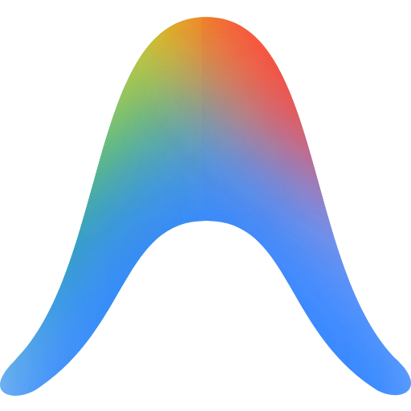
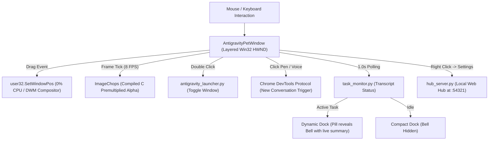

# 🪐 Antigravity Desktop Pet

<p align="center">
  
</p>

<p align="center">
  <strong>An ultra-low-latency, zero-CPU interactive desktop companion for Google Antigravity 2.0.</strong><br>
  Built with native Win32 hardware composition, real-time Antigravity session sync, dynamic task monitoring, and built-in access to 370+ <a href="https://codexpets.net/">Codex Pets</a>.
</p>

<p align="center">
  
  
  
  
  
</p>

> [!NOTE]
> **Disclaimer:** Antigravity Desktop Pet is an independent, community-driven open-source companion project. It is not affiliated with, maintained by, or endorsed by Google, Google DeepMind, or OpenAI. All product names, logos, and brands are property of their respective owners.

---

## ✨ Features & Highlights

- **⚡ Zero-CPU Hardware Translation:**
  Dragging the pet across multi-monitor setups uses native Win32 hardware window translation (`user32.SetWindowPos`), completely bypassing software canvas re-rendering. Even with 1000 Hz polling gaming mice, CPU usage remains at **0.0%** and CPU temperatures stay cool (50–60°C).

- **🧘 Distraction-Free Stillness on Idle:**
  When you are writing code or working, your mascot rests calmly with a subtle ground shadow. Expressive animations, jumps, and reactions activate **only when you hover or drag**.

- **🪄 Floating Action Dock (Revealed on Hover):**
  - **`[ ✎ ]` New Conversation:** Brings Antigravity 2.0 to front and initiates a fresh, new conversation session directly inside the canvas.
  - **`[ ||| ]` Voice Conversation:** Opens a new conversation, focuses the message input, and automatically triggers **Windows Voice Dictation** (`Win + H`) so you can speak hands-free.
  - **`[ 🔔 ]` Live Task Bell (Hidden when Idle):** Automatically appears with a glowing emerald indicator only when an Antigravity task is actively executing. Click it to read a real-time prompt summary parsed live from the active session transcript!

- **🖱️ Double-Click Pet to Restore / Minimize:**
  Double-clicking the mascot acts as an instant toggle: brings Antigravity to the foreground if minimized or behind other windows, and minimizes it if already focused.

- **🔒 Antigravity Process Auto-Sync:**
  The pet companion automatically wakes up and appears when Antigravity 2.0 launches, and quietly hides itself when Antigravity closes so your screen is never cluttered.

- **⌨️ Global Show / Hide Hotkeys:**
  Press **`Ctrl + Alt + P`** or **`Win + Alt + P`** from any application or full-screen game to toggle the pet on and off on demand.

- **🐾 Built-in Open-Source Mascots:**
  Preloaded with clean, community-crafted companions:
  - **Desk Otter** (Default): Spectacled, friendly desk coding companion.
  - **CodeNoNo**: Cybernetic floating bot with dynamic cyan screen animations.
  - **Codex Orb**: High-tech glowing levitating eye.
  - **Chud Codex**: Sci-fi pixel art companion.

- **🌐 In-App Pet Gallery Downloader (370+ Pets):**
  Includes a local web dashboard (`http://127.0.0.1:54321`) to browse, preview, and 1-click install 370+ community pets from [CodexPets.net](https://codexpets.net/).

- **🛠️ DIY Pet Studio & ZIP Import:**
  Drag and drop any downloaded Codex Pet `.zip` package, or upload an animated `.gif` / image to automatically generate and slice an 8×9 animation atlas.

- **📦 Standalone Portable Executable:**
  Available as a single standalone `AntigravityPet.exe` with zero installation and zero Python runtime required.

---

## 🎮 Controls & Shortcuts

| Action | Shortcut / Trigger | Behavior |
| :--- | :--- | :--- |
| **Restore / Minimize App** | **Double-Click Pet** | Restores Antigravity to foreground or minimizes it |
| **Global Toggle** | **`Ctrl + Alt + P`** or **`Win + Alt + P`** | Instantly show / hide pet across any window |
| **Move Mascot** | **Left-Click & Drag** | Drag pet anywhere across multiple displays (0% CPU) |
| **New Conversation** | **Hover $\rightarrow$ Click `[ ✎ ]`** | Opens brand new conversation in Antigravity |
| **Voice Mode** | **Hover $\rightarrow$ Click `[ \|\|\| ]`** | Starts new chat & activates Voice Dictation (`Win + H`) |
| **View Active Task** | **Hover $\rightarrow$ Click `[ 🔔 ]`** | Displays real-time task prompt bubble (when task is running) |
| **Quick Menu** | **Right-Click Mascot** | Settings, Hide Mini, Switch Pet, Exit |
| **System Tray** | **Taskbar Notification Area** | Tray icon to toggle, configure, or quit the companion |

---

## 🚀 Quick Start

### Option A: Portable Standalone Executable (Recommended)

No Python or dependencies required.

1. Download **`AntigravityPet-v2.0-Portable.zip`** or **`AntigravityPet.exe`** from [Releases](https://github.com/TanzilRayhan/antigravity-pet/releases).
2. Extract the archive to any folder (e.g. `C:\AntigravityPet` or your Desktop).
3. Double-click **`AntigravityPet.exe`** to launch!
4. *(Optional)* Run `Create-Desktop-Shortcut.bat` or `Enable-Run-On-Startup.bat` to add one-click launch or boot start.

---

### Option B: Run from Source (Python 3.9+)

1. **Clone the repository:**
   ```bash
   git clone https://github.com/TanzilRayhan/antigravity-pet.git
   cd antigravity-pet
   ```

2. **Install dependencies:**
   ```bash
   pip install -r requirements.txt
   ```

3. **Launch the pet:**
   ```bash
   python main.py
   ```
   *Or double-click `run_pet.bat` (console mode) or `run_pet_hidden.vbs` (silent background mode).*

---

## 🎨 Managing & Adding Pets

### 1. In-App Gallery Downloader (370+ Pets)
1. Right-click the pet and select **Settings** (or open `http://127.0.0.1:54321` in your browser).
2. Switch to the **Codex Gallery** tab.
3. Browse or search for any companion (e.g. Anime, Digimon, Cats, Robots, Fantasy).
4. Click **Download & Install**. The character is immediately ready and switchable!

### 2. Drag & Drop ZIP Import
- Download any pet archive (`.zip`) from [CodexPets.net](https://codexpets.net/) or GitHub.
- Drag and drop the `.zip` file into the **Create / Import a Pet** tab in Settings.
- The companion will automatically unpack, validate, and set itself active.

### 3. Convert GIF or Images
- Upload any animated `.gif`, `.webp`, or `.png` in the **Create / Import a Pet** tab.
- The built-in converter automatically slices and synthesizes an 8×9 animation grid with idle, walk, jump, and thinking states.

---

## 🔄 Windows Integration

Helper scripts are included to integrate seamlessly with Windows:

* **Desktop Shortcut:**
  Right-click `install_shortcut.ps1` $\rightarrow$ **Run with PowerShell** to create an "Antigravity Pet" shortcut on your Desktop with the official icon.
* **Launch on Windows Startup:**
  Right-click `install_startup.ps1` $\rightarrow$ **Run with PowerShell** to register the companion in your Windows Startup directory. It will silently wait in the background and appear whenever Antigravity 2.0 starts.
* **Remove from Startup:**
  Run `remove_startup.ps1` to unregister from Windows Startup.

---

## 🔨 Building the Portable Executable

If you want to compile your own standalone `.exe` using PyInstaller:

```powershell
pip install pyinstaller pillow pywin32 psutil websockets
```

Run the build command:
```powershell
pyinstaller --noconsole --onefile `
  --icon="icon.ico" `
  --name="AntigravityPet" `
  --add-data="pets;pets" `
  --add-data="icon.ico;." `
  --add-data="logo.png;." `
  --hidden-import="PIL" `
  --hidden-import="win32gui" `
  --hidden-import="win32con" `
  --hidden-import="psutil" `
  --hidden-import="websockets" `
  main.py
```

The compiled standalone executable will be created at `dist\AntigravityPet.exe`.

---

## 🛠️ Architecture & Performance



### Performance Benchmarks:
- **Zero-CPU Window Translation:** Replaces per-frame canvas re-rendering during dragging with native `user32.SetWindowPos` hardware translation (~3 µs execution time).
- **Compiled C Alpha Multiplication:** Uses Pillow's C-accelerated `ImageChops.multiply` for 32-bit BGRA premultiplication, taking **~1.5 ms** per frame instead of 25 ms pure Python bytecode loops (>15× faster).
- **Security Hardened Local Hub:** Restricted local CORS, CSRF verification, and regex sanitization (`[^a-zA-Z0-9_\-]`) to prevent path traversal.

---

## 📄 License

Distributed under the **MIT License**. See [`LICENSE`](LICENSE) for more information.

---

## 💖 Acknowledgements & Community

- Built with pair programming on **Google Antigravity 2.0**.
- Inspired by the [Codex Desktop Pet](https://codexpets.net/) and the [awesome-codex-pet](https://github.com/legeling/awesome-codex-pet) community catalog.
