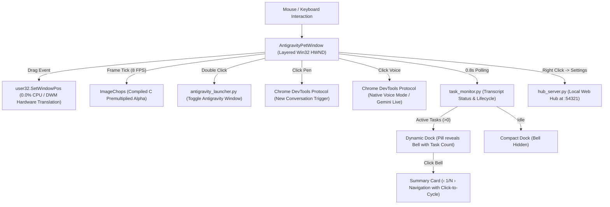

# Antigravity Desktop Pet

<p align="center">
  
</p>

<p align="center">
  <strong>An ultra-low-latency, zero-CPU interactive desktop companion for Google Antigravity 2.0.</strong><br>
  Engineered with native Win32 hardware composition, native Antigravity Voice Mode integration, real-time multi-task monitoring, customizable global shortcuts, and built-in access to 380+ <a href="https://codexpets.net/">Codex Pets</a>.
</p>

<p align="center">
  
  
  
  
  
  
</p>

<p align="center">
  <a href="https://youtu.be/85AJkZD1uu8" target="_blank">
    
  </a>
  <br>
  <a href="https://youtu.be/85AJkZD1uu8"><strong>Watch the Full Walkthrough & Demo on YouTube</strong></a>
</p>

> [!NOTE]
> **Disclaimer:** Antigravity Desktop Pet is an independent, community-driven open-source companion project. It is not affiliated with, maintained by, or endorsed by Google, Google DeepMind, or OpenAI. All product names, logos, and brands are property of their respective owners.

---

## Features & Highlights

- **Zero-CPU Hardware Translation:**
  Built with native Win32 layered windows (`user32.SetWindowPos`) composited directly via Windows DWM. Moving the mascot across multi-monitor setups at 1000 Hz mouse polling operates with **0.0% CPU overhead** and zero thermal spikes.

- **Native Antigravity Voice Mode (Gemini Live):**
  Clicking the waveform icon on the hover dock connects directly via Chrome DevTools Protocol (CDP) to bring Antigravity 2.0 to front and trigger its native Voice Mode—delivering instant, conversational AI coding hands-free.

- **Real-Time Task Notification & Multi-Task Navigation:**
  - **Live State Awareness:** Watches session transcripts in real time, detecting whether Antigravity is **Thinking & planning...**, **Executing tool...**, or **Processing results...**.
  - **Multi-Task Indicator & Switcher:** When multiple tasks are active, a count badge (`2`, `3`) appears on the notification bell. Clicking the summary card cycles through running tasks (`‹ 1/N ›`) to view prompt summaries.
  - **Distraction-Free Auto-Hide:** The notification bell dynamically illuminates only when an agent turn is actively working and hides completely when idle.

- **Customizable Global Keyboard Shortcuts:**
  Configure and record keyboard shortcuts directly from the Settings Hub with instant hot-reloading:
  - **Run & Exit Pet Companion** (Default: `Ctrl + Alt + P`): Launches the companion when closed; cleanly terminates the app and removes the tray icon when showing, with delayed relaunch suppression.
  - **Hide & Show Mini** (Default: `Ctrl + Alt + H`): Minimizes the companion to the Windows system tray or restores it to the desktop without exiting.
  - **Switch Pet** (Default: `Ctrl + Alt + N`): Cycles to the next installed companion mascot with speech bubble reaction.
  - **Switch Behavior Mode** (Default: `Ctrl + Alt + B`): Toggles between Zero-G Float (sine wave vertical hover) and Stationary (locked baseline position).
  - **Open Settings Hub** (Default: `Ctrl + Alt + S`): Opens the local Settings dashboard and Pet Gallery in your browser.
  - Each shortcut can be edited, customized, left blank to disable, or reset to defaults.

- **Modern Companion Hub & Pet Gallery:**
  Includes a local web dashboard (`http://127.0.0.1:54321`) styled with clean Windows 11 Fluent vector styling:
  - **My Pets:** Manage and switch active mascots, customize pet names and descriptions, or permanently delete unneeded pets.
  - **Pet Gallery:** Browse, filter, and 1-click install 380+ free community companions curated from [CodexPets.net](https://codexpets.net/) with animated card previews.
  - **Custom Pet Studio:** Drag and drop any Codex Pet `.zip` package or animated `.gif` / image to auto-synthesize an 8×9 animation atlas.
  - **Behavior & Appearance:** Instant scale adjustment (40% to 150%), Zero-G Float vs. Stationary modes, audio chimes, and startup preferences.

- **6 Bundled Starter Mascots:**
  Preloaded with clean, copyright-safe open-source companions:
  - **Desk Otter** (Default): Friendly, spectacled desk coding companion.
  - **AI Pulse**: Vibrant cyan AI robot with floating hands and feet.
  - **Diandian**: Calm, sleeping tabby-and-white feline mascot.
  - **CodeNoNo**: Futuristic floating bot with cyan animated visor.
  - **Codex Orb**: Sleek levitating cybernetic orb.
  - **Chud Codex**: Original grimdark chibi sci-fi pixel companion.

- **Double-Click Pet to Restore / Minimize:**
  Double-clicking the mascot acts as an instant shortcut: brings Antigravity to the foreground if minimized or behind other windows, and minimizes it if already focused.

- **Antigravity Process Auto-Sync:**
  The pet companion automatically wakes up when Antigravity 2.0 launches and quietly hibernates when Antigravity closes so your screen stays clean.

- **Standalone Portable Binary (v2.2.0):**
  Available as a single standalone `AntigravityPet.exe` with zero installation and zero Python runtime required.

---

## Controls & Shortcuts

| Action | Shortcut / Trigger | Behavior |
| :--- | :--- | :--- |
| **Run / Exit Pet** | **`Ctrl + Alt + P`** | Launches when closed; exits cleanly when pet is showing |
| **Hide / Show Mini** | **`Ctrl + Alt + H`** | Toggles visibility between desktop and system tray |
| **Switch Pet** | **`Ctrl + Alt + N`** | Cycles to the next installed companion mascot |
| **Switch Behavior Mode** | **`Ctrl + Alt + B`** | Toggles between Zero-G Float and Stationary |
| **Open Settings Hub** | **`Ctrl + Alt + S`** | Opens Pet Gallery and Settings in default browser |
| **Restore / Minimize App** | **Double-Click Pet** | Restores Antigravity to foreground or minimizes it |
| **Move Mascot** | **Left-Click & Drag** | Drag pet anywhere across multiple displays (0.0% CPU) |
| **New Conversation** | **Hover $\rightarrow$ Click `[ ✎ ]`** | Initiates a fresh new conversation in Antigravity |
| **Native Voice Mode** | **Hover $\rightarrow$ Click `[ \|\|\| ]`** | Brings Antigravity to front and activates Voice Mode |
| **View Active Tasks** | **Hover $\rightarrow$ Click `[ 🔔 ]`** | Displays live task prompt bubble (illuminates during active tasks) |
| **Cycle Multiple Tasks** | **Click Summary Card** | Smoothly switches between running tasks (`‹ 1/N ›`) |
| **Quick Menu** | **Right-Click Mascot** | Settings, Hide Mini, Switch Pet, Exit |
| **System Tray** | **Taskbar Notification Area** | Tray icon to toggle, configure, or quit the companion |

---

## Quick Start

### Option A: Portable Standalone Executable (Recommended)

No Python or external dependencies required.

1. Download **`AntigravityPet-v2.2.0-Portable.zip`** from [Releases](https://github.com/TanzilRayhan/antigravity-pet/releases).
2. Extract the archive to any folder (e.g. `C:\AntigravityPet` or your Desktop).
3. Double-click **`AntigravityPet.exe`** to launch.
4. *(Optional)* Run `Create-Desktop-Shortcut.bat` or `Enable-Run-On-Startup.bat` to add a desktop icon or autostart with Windows.

---

### Option B: Run from Source (Python 3.9+)

1. **Clone the repository:**
   ```bash
   git clone https://github.com/TanzilRayhan/antigravity-pet.git
   cd antigravity-pet
   ```

2. **Install dependencies:**
   ```bash
   pip install -r requirements.txt
   ```

3. **Launch the pet:**
   ```bash
   python main.py
   ```
   *Or run `run_pet_hidden.vbs` for silent background execution.*

---

## Managing & Adding Pets

### 1. In-App Gallery Downloader (380+ Pets)
1. Right-click the pet and select **Settings** (or press `Ctrl + Alt + S` / open `http://127.0.0.1:54321`).
2. Switch to the **Pet Gallery** tab.
3. Browse or search for any companion (e.g. Digimon, Cat, Robot, Gaming, Anime).
4. Click **Install**. The companion downloads and is immediately ready to activate.
   *All community gallery mascots are curated from [CodexPets.net](https://codexpets.net/).*

### 2. Drag & Drop ZIP Import
- Download any pet archive (`.zip`) from [CodexPets.net](https://codexpets.net/) or GitHub.
- Drag and drop the `.zip` file into the **Custom Pet** tab in Settings.
- The companion will automatically unpack, validate, and set itself active.

### 3. Convert GIF or Images
- Upload any animated `.gif`, `.webp`, or `.png` in the **Custom Pet** tab.
- The built-in converter automatically slices and synthesizes an 8×9 animation grid with idle, walk, jump, and waving states.

---

## Windows Integration

Helper scripts are included to integrate seamlessly with Windows:

* **Desktop Shortcut:**
  Run `Create-Desktop-Shortcut.bat` or right-click `install_shortcut.ps1` $\rightarrow$ **Run with PowerShell** to create an "Antigravity Pet" shortcut on your Desktop with the official icon and global hotkey.
* **Launch on Windows Startup:**
  Run `Enable-Run-On-Startup.bat` or toggle in the Settings Hub to register the companion in your Windows Startup directory. It will silently wait in the background and appear whenever Antigravity 2.0 starts.
* **Remove from Startup:**
  Run `Disable-Run-On-Startup.bat` or `remove_startup.ps1` to unregister from Windows Startup.

---

## Building the Portable Executable

If you want to compile your own standalone `.exe` using PyInstaller:

```powershell
pip install pyinstaller pillow pywin32 psutil websockets
```

Run the build command:
```powershell
pyinstaller --noconfirm AntigravityPet.spec
```

The compiled standalone executable will be created at `dist\AntigravityPet.exe`.

---

## Architecture & Engineering



### Engineering Highlights:
- **Zero-CPU Window Translation:** Replaces per-frame canvas re-rendering during dragging with native `user32.SetWindowPos` hardware translation (~3 µs execution time).
- **Compiled C Alpha Multiplication:** Uses Pillow's C-accelerated `ImageChops.multiply` for 32-bit BGRA premultiplication, taking **~1.5 ms** per frame instead of 25 ms pure Python bytecode loops (>15× faster).
- **Chrome DevTools Protocol Bridge:** Interacts directly with Antigravity's embedded browser runtime port to trigger state transitions deterministically without fragile simulated clicks.
- **Security Hardened Local Hub:** Restricted local CORS, CSRF verification, and regex sanitization (`[^a-zA-Z0-9_\-]`) to prevent path traversal.

---

## License

Distributed under the **MIT License**. See [`LICENSE`](LICENSE) for more information.

---

## Acknowledgements & Community

- Built with pair programming on **Google Antigravity 2.0**.
- Mascot gallery curated from and inspired by [CodexPets.net](https://codexpets.net/).
